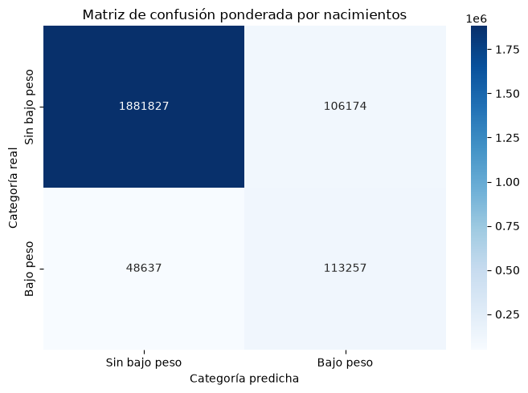
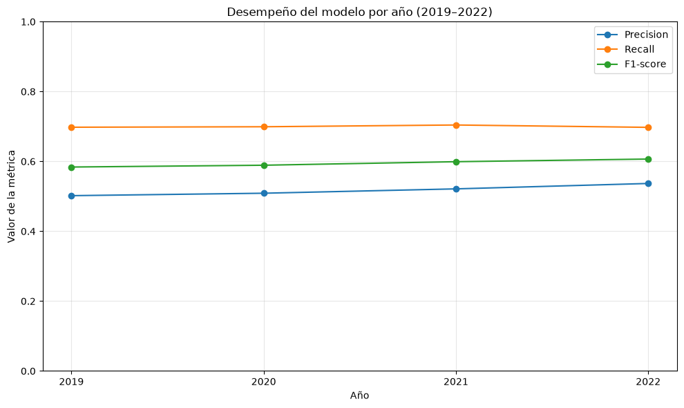

# Resumen de resultados del modelo

## 1. Modelo evaluado

Se evaluó un clasificador **Random Forest** para clasificar registros de nacimientos según la presencia de bajo peso al nacer, definido como un peso inferior a 2.500 gramos.

La configuración definitiva utilizó balanceo de clases (`class_weight="balanced"`) y los siguientes hiperparámetros:

- `n_estimators`: 300
- `max_depth`: 20
- `max_features`: 0.5
- `min_samples_split`: 2
- `min_samples_leaf`: 1

## 2. Evaluación temporal

Se utilizaron los registros de 2005–2018 para el entrenamiento y la selección del modelo, reservando los años 2019–2022 para la evaluación final.

El conjunto de prueba representó **2.149.895 nacimientos**. Las métricas se calcularon ponderando cada registro según la cantidad de nacimientos que representa (`nacimientos_cantidad`).

## 3. Métricas generales

Resultados correspondientes a la clase positiva: **Bajo peso**.

| Métrica | Resultado |
|---|---:|
| Precision | 0,52 |
| Recall | 0,70 |
| F1-score | 0,59 |

El modelo identificó aproximadamente el 70 % de los nacimientos con bajo peso presentes en el conjunto de prueba. Sin embargo, la Precision de 0,52 indica que una proporción considerable de las predicciones positivas fueron falsos positivos.

## 4. Matriz de confusión

Los siguientes valores representan cantidades de nacimientos, no cantidad de filas del conjunto de datos.

| Valores reales / Predicciones | Sin bajo peso | Bajo peso |
|---|---:|---:|
| Sin bajo peso | 1.881.827 | 106.174 |
| Bajo peso | 48.637 | 113.257 |

La matriz permite observar tanto los aciertos como los errores de clasificación en ambas clases.

## 5. Evolución de las métricas por año

| Año | Nacimientos | Precision | Recall | F1-score |
|---|---:|---:|---:|---:|
| 2019 | 620.606 | 0,5019 | 0,6978 | 0,5839 |
| 2020 | 521.370 | 0,5089 | 0,6992 | 0,5891 |
| 2021 | 517.092 | 0,5214 | 0,7042 | 0,5992 |
| 2022 | 490.827 | 0,5368 | 0,6975 | 0,6067 |

El Recall se mantuvo relativamente estable durante el período evaluado, mientras que Precision y F1-score mostraron una mejora gradual.

## 6. Interpretación y limitaciones

Los resultados muestran que el modelo logró identificar una proporción importante de los registros correspondientes a nacimientos con bajo peso. No obstante, la cantidad de falsos positivos evidencia limitaciones en la precisión de las clasificaciones.

El análisis tiene un alcance retrospectivo y se basa en registros agrupados. Además, la variable semana de gestación se registra al momento del nacimiento, por lo que el modelo no constituye una herramienta de predicción prenatal.

Las relaciones identificadas no permiten establecer causalidad ni justificar decisiones clínicas.

## 7. Conclusión

El modelo Random Forest balanceado obtuvo un Recall de 0,70 y un F1-score de 0,59 para la clase de bajo peso al nacer en el período de prueba 2019–2022. Estos resultados permiten considerar su utilidad para el análisis retrospectivo de registros históricos, aunque también evidencian limitaciones que deben tenerse en cuenta al interpretar sus predicciones.